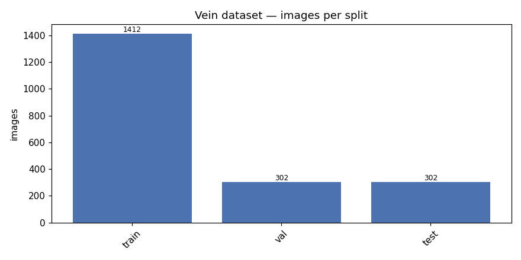
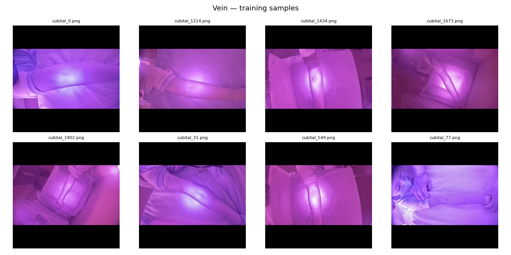
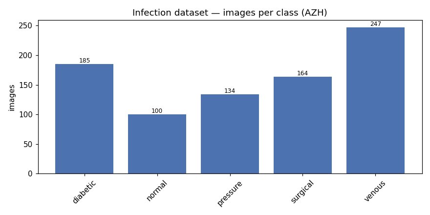
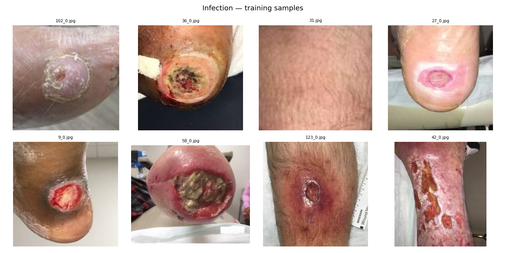
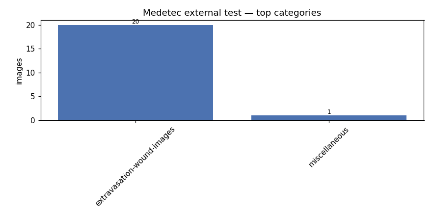

# Data Report

Generated by `scripts/data_report.py`. Do not edit by hand.

## Vein module (pre-cannulation)

Split level: **subject** (seed 42, image size 512×512)

| Split | Images | Subjects |
|---|---:|---:|
| train | 1412 | 706 |
| val | 302 | 151 |
| test | 302 | 151 |
| **total** | **2016** | **1008** |

Resolution after processing: 512×512 (uniform by construction).

Vein pixels occupy **0.6%** of a frame on average (n=100 sampled). This imbalance is why the Phase 3 loss pairs BCE with Dice rather than using BCE alone.

## Infection module (post-cannulation)

> **Proxy labels.** PROXY labels. AZH provides wound type, not infection status. is_infected=1 for {diabetic,pressure,venous,surgical}, 0 for {normal}, background dropped. Report all metrics as proxy-label performance.

> **Split caveat.** Split by source wound, not by file: AZH ships multiple ROI crops of one wound as <id>_0, <id>_1, so a file-level split leaks the same wound across train and test. No patient IDs are published, so two wounds on the same patient may still straddle splits.

| Class | Train | Val | Test | Total |
|---|---:|---:|---:|---:|
| diabetic | 130 | 28 | 27 | 185 |
| normal | 70 | 15 | 15 | 100 |
| pressure | 97 | 18 | 19 | 134 |
| surgical | 114 | 23 | 27 | 164 |
| venous | 185 | 27 | 35 | 247 |
| **total** | **596** | **111** | **123** | **830** |

Proxy binary target (`is_infected`):

| Split | Wound (1) | Normal skin (0) | Ratio |
|---|---:|---:|---:|
| train | 526 | 70 | 7.5:1 |
| val | 96 | 15 | 6.4:1 |
| test | 108 | 15 | 7.2:1 |

The positive class outnumbers the negative several times over. Phase 5 must weight the LightGBM classes or report balanced metrics; raw accuracy on this split would be misleading.

### External test set — Medetec (21 images)

Held out entirely. Different cameras, clinicians, and decade, so performance here is the honest transfer estimate.

| Category | Images |
|---|---:|
| extravasation-wound-images | 20  ← IV-infiltration injury |
| miscellaneous | 1 |

Native resolution varies: 66×78 to 2624×2623, mean 235×238 (n=100 sampled). Resizing happens in the Dataset, not on disk, so the originals stay available for the ROI crops Phase 5 needs.

## What this data cannot tell us

1. **No infection ground truth.** Nothing here labels a wound infected. The binary target is a wound-vs-skin proxy.
2. **No longitudinal series.** No dataset photographs the same site on consecutive days, so the Phase 5 temporal tracker has no real validation set — only the synthetic progression notebook.
3. **No cannula images.** Phase 4 needs ~100–200 hand-labelled hub images that do not exist publicly.
4. **No IV sites at all.** Every wound image here is a chronic or surgical wound, not a cannula insertion site. The extravasation gallery is the nearest analogue and it is small.
