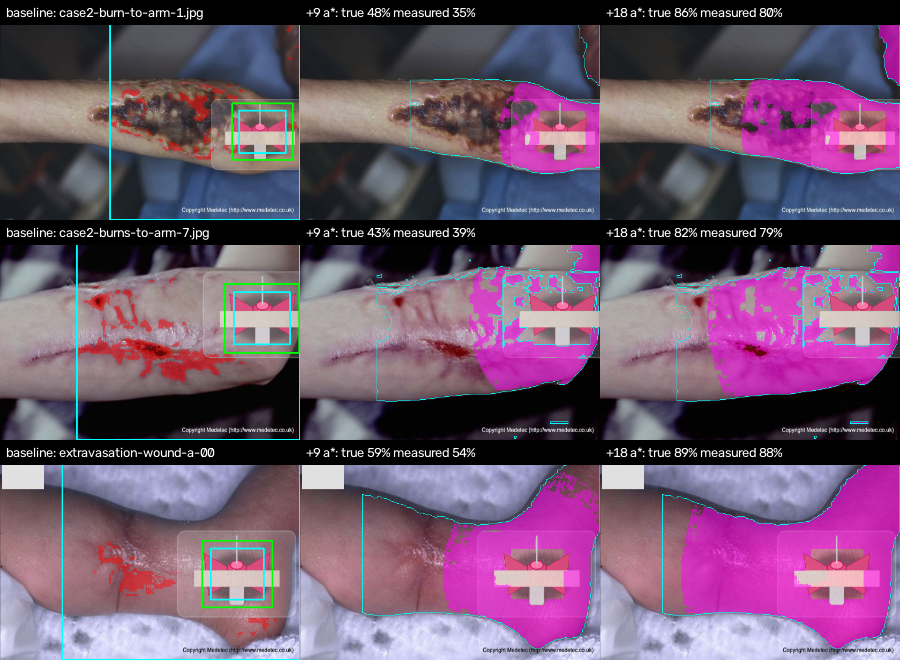

# Site-Change Monitoring — Controlled Validation

**What this shows:** that the deployed pipeline *measures* redness change
correctly, on real limb photos with a known amount of redness added, and is not
fooled by lighting, white balance, compression or moving the phone.

**What it does not show:** that measured redness predicts phlebitis or
infection. That needs real IV-site photos with nurse assessments. Every image
here is **SIMULATED** — a procedural cannula hub and injected redness — and
each PNG carries an `IntelliCannula-Simulated` marker.

Reproduce: `cd backend && ../infection_module/.venv/bin/python ../scripts/validate_site_monitoring.py`
· raw: [`site_monitoring_validation.json`](site_monitoring_validation.json),
[`site_method_deployed.json`](site_method_deployed.json),
[`site_method_comparison_before_adoption.json`](site_method_comparison_before_adoption.json)
· images: `data/demo/site_validation/`

## Method

- **Backgrounds:** the real IV-hand photo + 11 Medetec limb photos with visible
  skin. Wounds already in a photo are present on every "day", so they cancel in
  the change measurement.
- **Hub placement:** automatic — the skin point furthest from non-skin; every
  hub colour and size (18/22/26% of width) tried before counting a miss.
- **Follow-ups:** +3, 6, 9, 12, 18, 24 CIELAB a* units of redness, Gaussian
  spread 1.0 and 1.6 hub widths, **on skin only** (erythema does not redden
  tape, plastic or sheets) — 12 per background.
- **Nuisance-only photos (true change 0):** exposure ×0.75 and ×1.2, warm and
  cool white balance, JPEG quality 55, phone moved 6° + shifted.
- **Ground truth:** share of the baseline's measured skin ring whose a* rose by
  ≥ 6 in the saved image (the system's own threshold). Injected-amount truth
  gives the same conclusions (see JSON).
- **Measured:** `change_since_baseline` from `app.core.ml.run_site_check` —
  the real API code path, including the cannula detector and scene check.

## Finding 1 — the original change measurement was wrong, and was replaced

The first method subtracted two in-photo measurements (each relative to skin far
away in the *same* photo). Spreading redness reaches that far skin and cancels
itself, so change was under-measured. Replaced by **baseline-anchored**
comparison: align the follow-up to the baseline (homography from the scene
check), match colours on white/grey objects **away from the site**, then count
skin pixels whose a* rose by ≥ 6.

| Same 48 follow-ups | Old (in-photo reference) | **Adopted (baseline-anchored)** |
|---|---:|---:|
| Correlation with true change | 0.59 | **0.995** |
| Mean absolute error | 21.5 pts | **3.6 pts** |
| Visible-change sensitivity / specificity | 0.84 / 0.69 | **1.00 / 1.00** |
| Change from warm white balance | 14.1 pts | **0.0 pts** |

Two refinements were each re-validated after a regression showed up:
neutral-object positions are taken from the baseline (a colour cast pushed a
white sheet out of the "neutral" range), and only neutrals *outside the measured
ring* are used (a transparent dressing over reddening skin cancelled real change;
r had fallen to 0.94).

## Finding 2 — the cannula detector loses confidence on red skin

13 of 48 follow-ups were refused as "unable to verify the cannula" — the more
inflamed the site, the more likely. Fix: on a follow-up whose baseline hub **was
verified** and whose scene match is confirmed, a weak detection (0.25–0.50) is
accepted with the hub position taken from the baseline. After the fix: 0 of 48
refused (17 via baseline position across all runs). Nothing hub-like (< 0.25),
or a weak detection on a baseline photo, is still rejected.

## Finding 3 — no white/grey reference, no reliable comparison

On 2 of the 4 backgrounds nothing white or grey is visible away from the site,
so a lighting change cannot be told from redness (the only false alarm, 1/23,
was such a photo). These comparisons are now reported as **"Unable to compare
reliably — no white/grey reference in frame"** and the user is asked to include
a white sheet or paper.

## Results (deployed pipeline)

| | As photographed | With a white card added where the scene had none |
|---|---:|---:|
| Follow-ups compared | 24 / 48 | 36 / 48 |
| Deferred (no colour reference) | 24 | 12 |
| Correlation with true change | **0.995** | **0.996** |
| Mean absolute error | 3.6 pts | 3.0 pts |
| Visible change (≥ 10 pts): detected | 16 / 16 | 24 / 24 |
| No change: correctly not flagged | 8 / 8 | 12 / 12 |
| Nuisance photos falsely flagged | **0 / 11** | **0 / 16** |

Mean true → measured change by injected amount (with card):
+3: 0 → 0 · +6: 0 → 0 · +9: 38% → 32% · +12: 54% → 49% · +18: 70% → 67% ·
+24: 78% → 75%. The method slightly **under**-measures (worst single case:
burned arm at +9, 48% true vs 35% measured) — it errs towards missing a little
change rather than inventing it.

*Baseline (red = skin redder than far skin in the same photo — wounds included)
· change since baseline at +9 and +18 a\* (magenta = redder than baseline; the
pre-existing wounds are correctly not counted).*

## Limitations of this validation

- **Only 4 of 12 backgrounds could be used:** the cannula detector (trained on
  90 synthetic images) did not find the drawn hub on the other 8, including the
  real IV-hand photo, whatever the hub colour or size.
- The remaining deferral (one background even with a card) is framing: the
  detector only recognises hubs filling 18–32% of the width, so the measured
  ring covers the whole 560-px photo and nothing lies outside it to use as a
  reference. Wider framing needs a detector trained on real photos.
- Redness is injected as a smooth Gaussian; real phlebitis can streak along the
  vein. Real lighting changes are not perfectly global.
- 4 backgrounds, mostly light skin. Darker skin types are not covered.
- None of this measures clinical accuracy.
