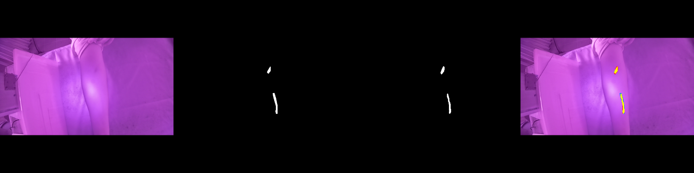
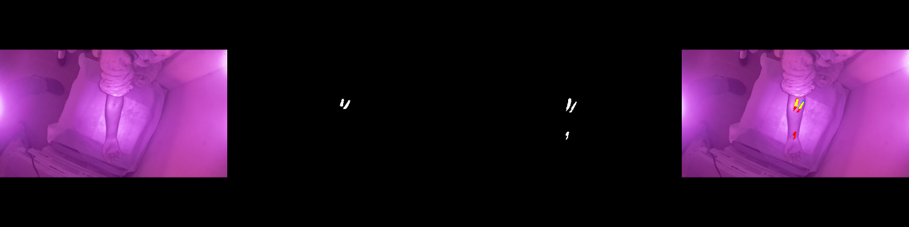
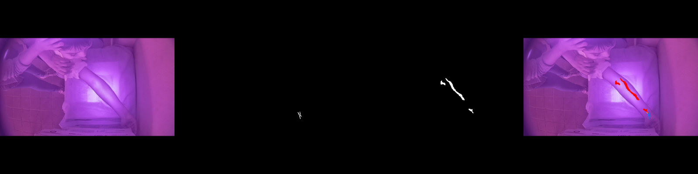

# Vein Segmentation — Experiments and Error Analysis

Deployed configuration: epoch-16 checkpoint (`attention_unet_best.pt`, backed up
as `attention_unet_epoch16_final.pt`), threshold **0.9**, connected components
under **60 px** removed. Reproduce:

```bash
infection_module/.venv/bin/python -m vein_module.src.postprocess_experiments   # val only
infection_module/.venv/bin/python -m vein_module.src.error_analysis            # test, analysis only
```

Raw outputs: [`vein_postprocess_experiments.json`](vein_postprocess_experiments.json),
[`vein_error_analysis.json`](vein_error_analysis.json).

## 1. Inference-time experiments (validation split, 285 images with a vein)

Selection used validation only. The test split was not read.

| Configuration | Dice | IoU | Precision | Recall | Decision |
|---|---:|---:|---:|---:|---|
| **thr 0.90, min 60 px (deployed)** | **0.575** | 0.419 | 0.501 | 0.759 | kept |
| thr 0.85, min 60 px | 0.562 | 0.406 | 0.473 | 0.788 | worse Dice |
| thr 0.95, min 60 px | 0.592 | 0.435 | 0.557 | 0.701 | not adopted — see below |
| flip TTA, thr 0.90 | 0.580 | 0.424 | 0.515 | 0.748 | +0.005 Dice for 2× latency; not adopted |
| hysteresis 0.90 / 0.50 | 0.517 | 0.365 | 0.399 | 0.856 | worse |
| hysteresis 0.90 / 0.70 | 0.540 | 0.386 | 0.434 | 0.826 | worse |
| flip TTA + hysteresis 0.90 / 0.70 | 0.547 | 0.393 | 0.443 | 0.821 | worse |

Latency on Apple MPS (median, model forward only): 61 ms plain, 122 ms with TTA.

**Why 0.95 was not adopted although its Dice is higher.** The gain comes entirely
from discarding uncertain pixels: recall falls from 0.759 to 0.701, i.e. ~6% more
of the annotated vein is missed, concentrated in faint and thin segments. For a
vein-finding aid a missed vein is the costlier error. The choice is recorded as a
judgement, not hidden; `VEIN_MASK_THRESHOLD=0.95` switches to it.

**Not tried, deliberately.** Changing CLAHE or other preprocessing at inference
only: the network was trained with CLAHE (clip 2.0, 8×8), so any change would be
a train/inference mismatch. Re-training with new augmentation or losses: training
had plateaued (val Dice 0.475 at epoch 16, no gain through epoch 19 as the cosine
learning rate reached ~0), and nothing in the analysis below points to a loss or
augmentation fix that would justify a new run without new data.

**Outcome: no inference-time change improved the model enough to adopt.** The
deployed configuration and its test result are unchanged.

## 2. Final test result (288 test images with a vein, evaluated once)

| Metric | Original (epoch 6, thr 0.5) | Final (epoch 16, thr 0.9, min 60) |
|---|---:|---:|
| Dice (mean) | 0.370 | **0.567** |
| IoU | 0.239 | **0.413** |
| Precision | 0.262 | **0.495** |
| Recall | 0.814 | 0.758 |

Per-image Dice distribution (final): median **0.610**, 10th percentile 0.350,
90th percentile 0.741; **17.7%** of images score below 0.4.

## 3. Where the errors are

Using CUBITAL's three-class masks (background / arm / vein):

| Error type | Share |
|---|---:|
| False positives within 2 px of a true vein (vein drawn too wide) | 46.8% of FP pixels |
| False positives on the arm, away from annotated veins | 52.8% |
| False positives off the arm (bedsheet, background) | **0.3%** |

| Missed veins | Recall |
|---|---:|
| Thin vein pixels (local width < 4 px; 22.6% of all vein pixels) | 0.699 |
| Wider vein pixels | 0.759 |

- **Fragmentation:** median 1.5 predicted components per annotated component —
  veins are often broken into pieces.
- **Contrast:** Dice by arm-contrast tercile — low 0.591, mid 0.575, high 0.536.
  Low contrast is *not* the main failure; high-contrast frames score lowest,
  plausibly because more visible veins are present than were annotated.
- **Annotation incompleteness (hypothesis, not measured):** in the worst case
  (frame 743, Dice 0.02) the annotation covers a short segment near the wrist
  while the model marks a long, clearly visible vein higher on the forearm. Some
  "false positives on the arm" are likely unannotated real veins. Confirming this
  needs re-annotation, so the metrics above are not adjusted for it.

## 4. Data integrity checks

| Check | Result |
|---|---|
| Subjects appearing in more than one split | 0 (train/val, train/test, val/test) |
| Pixel-identical images across splits | 0 |
| Masks whose vein pixels fall >5% outside the annotated arm (pairing error) | 0 |
| Mask resizing | nearest-neighbour (no interpolated labels); CUBITAL frames are already 512×512 |

## 5. Examples (test split)

NIR frame · ground truth · prediction · overlay (yellow correct, red false
positive, blue missed).

| | Frame | Dice |
|---|---|---:|
| Best | 290 | 0.838 |
| Median (used as the demo image) | 942 | 0.611 |
| 10th percentile | 1672 | 0.343 |
| Worst | 743 | 0.017 |






## 6. What would actually improve it

1. More annotated data, especially adults — CUBITAL is ages 5–22.
2. A re-annotation pass on a sample of "false-positive on arm" regions, to
   measure how much is annotation incompleteness.
3. Images from the actual NIR device that will be deployed (see README: NIR
   hardware), since a different rig is a domain shift these numbers do not cover.
