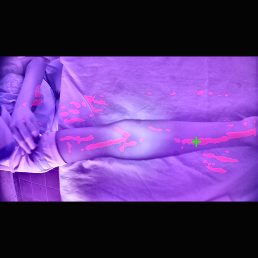
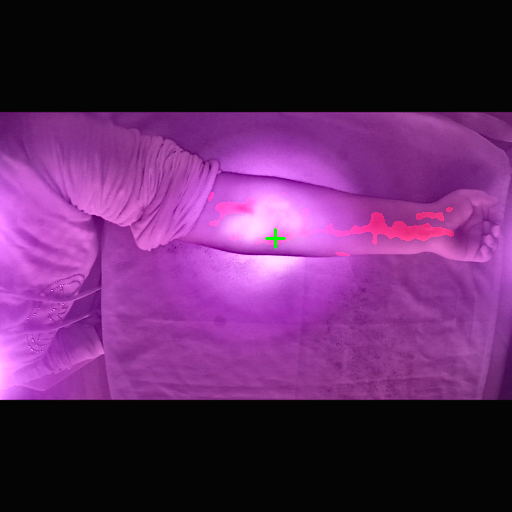
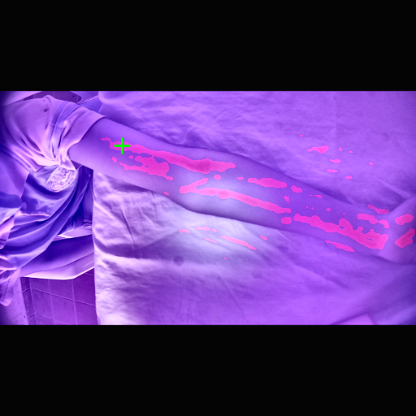
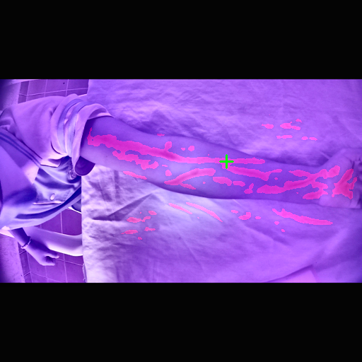
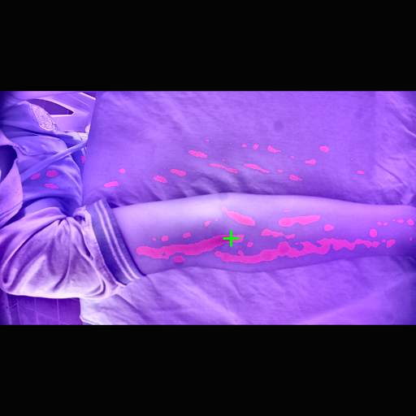
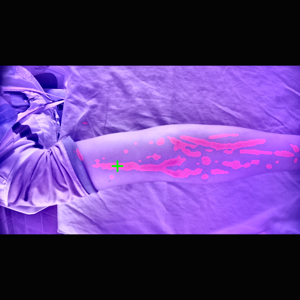
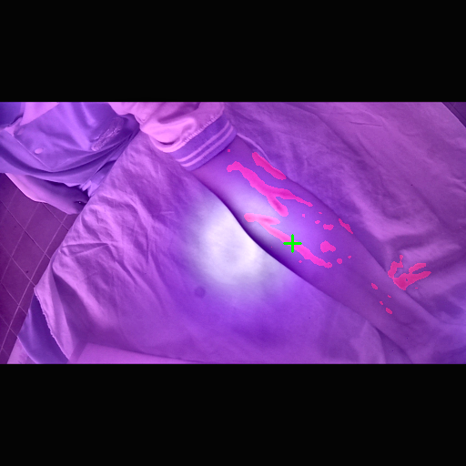

# Vein Module — Evaluation Report

Generated by `vein_module/src/evaluate.py`. Do not edit by hand.

Checkpoint: `/Users/sastikamohanraj/Development/intellicannula/vein_module/models/attention_unet_best.pt` (epoch 6)
Test images: 302  ·  threshold 0.5

## Segmentation

Scored over the **288 test images that contain an annotated vein**. The other 14 have empty masks and are reported separately below — averaging them into the headline would inflate it and could hide a model that predicts nothing.

| Metric | Value |
|---|---:|
| Dice | 0.3698 |
| IoU | 0.2390 |
| Precision | 0.2621 |
| Recall | 0.8141 |

| Diagnostic | Value |
|---|---:|
| Dice incl. empty-mask images | 0.3527 |
| Empty masks correctly left blank | 0% |
| Images predicted entirely background | 0% |

A high value in that last row means the network collapsed to the majority class. Vein pixels are only ~0.45% of a CUBITAL frame, so predicting background everywhere is a strong local minimum — it is the first failure to check for, not a rounding detail.

## Insertion site selection

A site was returned for **77%** of test images; mean confidence 0.214. Images with no site returned are not failures — the selector refuses when no segment meets the minimum width and straightness bar, which is the intended behaviour.

### Agreement with nurse-marked points

> Not computed — no nurse annotation file was supplied. CUBITAL ships 384 nurse-annotated samples; pass `--annotations` once they are available.

## Examples

Red = predicted vein mask · green cross = selected site · cyan cross = nurse-marked point.

## Known failure: predictions land off the patient

The overlays show vein-shaped false positives on the **bedsheet**, and on some images the selected insertion site is placed off the arm entirely. That is the direct cause of the precision/recall split above (recall high, precision low): the network over-predicts, and creased linen produces exactly the elongated ridge structure both the Frangi channel and the network are tuned to find.

**A site marker on a bedsheet is a clinically unacceptable output**, not a cosmetic issue, and it is not fixed by thresholding.

The fix is already available in the data and was discarded. CUBITAL masks are three-class — `0` background, `1` arm, `2` vein — and the loader keeps only class 2. Training the network to predict the arm as well, then intersecting the vein prediction with it, constrains candidates to the limb for free. That is the top priority for the next training run.

## Limitations

- **Under-trained.** This checkpoint is from epoch 6 of a planned 25. Validation Dice was still climbing monotonically when the run was stopped (0.133 → 0.179 → 0.204 → 0.217 → 0.240 → 0.353), so these numbers are a lower bound, not a converged result.
- **Paediatric cohort.** CUBITAL is 1,008 subjects aged 5–22 (median 11), 97% recorded as slim, 42 obese. The clinical need is in elderly and obese adults, where veins are harder to find. Transfer to that population is untested and should not be assumed.
- Trained on NIR imagery. Deploying against an RGB camera is a domain shift this number does not measure.
- The needle-angle output is a heuristic proxy for depth, not a measurement. See `site_selector.estimate_needle_angle`.
- Test subjects are disjoint from training subjects, but all come from the same capture rig and population. Cross-dataset transfer is untested until U-DAVIS is available.
